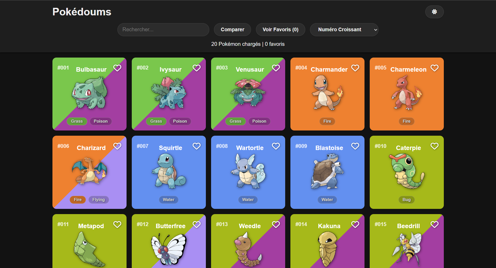

<h1 align="center">PokéDoums</h1>

<p align="center">Un explorateur Pokémon rapide et accessible, écrit en TypeScript pur et branché sur la PokéAPI.</p>

<p align="center">
  
  
  
  
  
  <a href="https://front-end-projet-gamma.vercel.app/"></a>
</p>

<p align="center"></p>

## À propos

PokéDoums est un projet d'école réalisé dans le cadre du module Front-End.
L'objectif : construire une application multi-pages sans framework, uniquement en TypeScript et avec Vite.
Les données viennent de la [PokéAPI](https://pokeapi.co/) (v2) : liste, fiches détaillées et espèces.
L'accent est mis sur l'expérience utilisateur : chargement progressif, favoris, comparaison et navigation au clavier.

## Fonctionnalités

- **Grille paginée** : les Pokémon sont chargés par lots de 20, avec un bouton « Voir plus » et des cartes squelettes pendant le chargement.
- **Cartes aux couleurs des types** : fond uni ou dégradé bicolore selon le ou les types, badges de type colorés.
- **Recherche instantanée** : filtrage par nom à la frappe, raccourci `Ctrl + K` / `Cmd + K` pour placer le curseur dans la barre.
- **Tri** : par numéro (croissant / décroissant) ou par nom (A-Z / Z-A).
- **Favoris** : ajout et retrait depuis la grille, la fiche ou la comparaison, filtre « Voir Favoris », persistance via `localStorage`.
- **Fiche détaillée** : artwork officiel, types, description en français (repli sur l'anglais), poids, taille, expérience de base et barres de statistiques colorées.
- **Navigation entre fiches** : liens vers le Pokémon précédent et suivant, fil d'Ariane vers l'accueil.
- **Mode comparaison** : sélection de deux Pokémon dans la grille, affichage côte à côte, mise en évidence de la meilleure stat et comparaison des moyennes (`>`, `<`, `=`).
- **Thème clair / sombre** : bascule mémorisée dans `localStorage` et partagée entre les pages.
- **Accessibilité clavier** : cartes focusables, navigation aux flèches dans la grille (calcul du nombre de colonnes), validation avec `Entrée`.
- **Gestion des erreurs** : message d'erreur et bouton « Réessayer » si l'API ne répond pas.

## Stack technique

| Côté | Technologies |
| --- | --- |
| Front | TypeScript (strict), HTML5, CSS3, Font Awesome |
| Build | Vite |
| Données | PokéAPI v2 (REST, `fetch`) |
| Qualité | oxlint, oxfmt |
| Déploiement | Vercel |

## Architecture

```text
.
├── index.html          # Accueil : grille, recherche, tri, favoris
├── pokemon.html        # Fiche détaillée (?id=)
├── compare.html        # Comparaison de deux Pokémon (?id1=&id2=)
├── public/             # Assets statiques
└── src/
    ├── main.ts         # Logique de la page d'accueil
    ├── pokemon.ts      # Logique de la fiche détaillée
    ├── compare.ts      # Logique de la comparaison
    ├── components/     # Génération des cartes Pokémon
    ├── services/       # Appels à la PokéAPI
    ├── types/          # Interfaces TypeScript des réponses de l'API
    └── utils/          # Palette de couleurs par type
```

- `src/components/` : `card.ts` produit le HTML d'une carte (couleurs, badges, bouton favori).
- `src/services/` : `api.ts` centralise les requêtes et lève une erreur si la réponse n'est pas OK.
- `src/types/` : typage des objets Pokémon, espèces, stats et chaînes d'évolution.
- `src/utils/` : `colors.ts` associe chaque type à sa couleur officielle.

## Lancer le projet en local

**Prérequis** : Node.js (version récente compatible avec Vite 7) et npm.

1. Cloner le dépôt :

   ```bash
   git clone https://github.com/madou752/front_end_projet.git
   cd front_end_projet
   ```

2. Installer les dépendances :

   ```bash
   npm install
   ```

3. Vérifier le fichier `.env` à la racine. Il ne contient que l'URL publique de la PokéAPI :

   ```env
   VITE_BASE_URL=https://pokeapi.co/api/v2
   ```

4. Lancer le serveur de développement :

   ```bash
   npm run dev
   ```

Autres scripts utiles :

| Commande | Rôle |
| --- | --- |
| `npm run build` | Vérification TypeScript (`tsc`) puis build de production |
| `npm run preview` | Sert le build de production en local |
| `npm run lint` / `npm run lint:fix` | Analyse et correction avec oxlint |
| `npm run format` / `npm run format:check` | Formatage avec oxfmt |

## Ce que j'ai appris

- **Structurer une app sans framework** : séparer services, composants, types et utilitaires pour garder trois pages lisibles.
- **Typer une API externe** : écrire les interfaces TypeScript des réponses de la PokéAPI en mode `strict`.
- **Optimiser les appels réseau** : paralléliser les requêtes de détails avec `Promise.all` et afficher des squelettes pendant l'attente.
- **Penser accessibilité** : rendre une grille de cartes navigable aux flèches en calculant dynamiquement le nombre de colonnes.

## Auteur

**Mehdi Hammadou** (Madou)
[Portfolio](https://portfoliohammadoumehdi.vercel.app/) · [GitHub](https://github.com/madou752)
